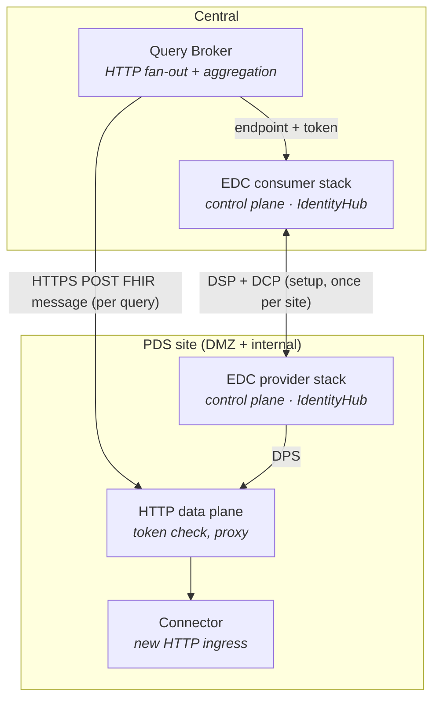
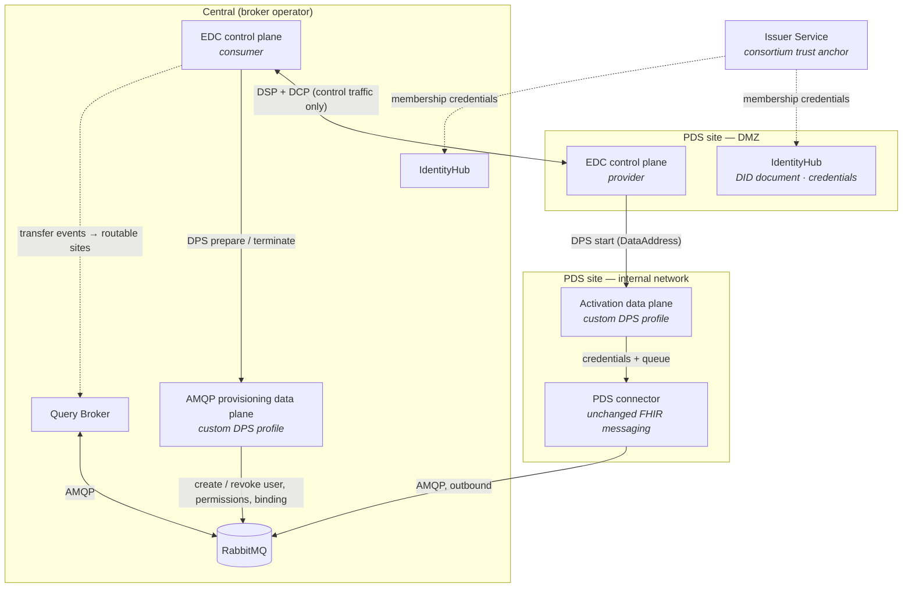
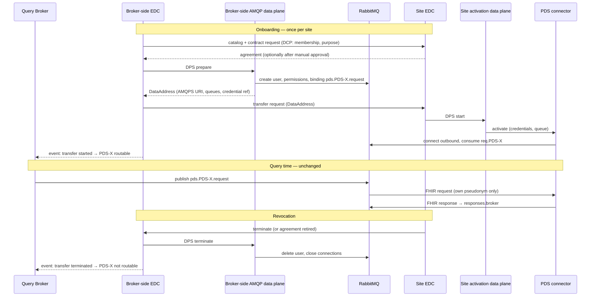
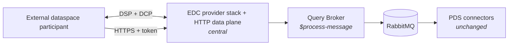
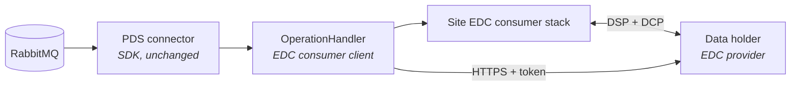

# Eclipse Dataspace Components — Fit Assessment for the Query Broker

> Dated research report, 2026-10-21 (immutable snapshot — supersede with a newer dated report, do not edit).
> Repository state: `840628c` (Query Broker 0.10.1; arc42 docs 0.10.0, ADR-001 … ADR-013).
> Method: `architecture-dev` evaluation. Baseline = this repository's arc42 documentation, ADRs,
> [IMPLEMENTATION_PLAN.md](../IMPLEMENTATION_PLAN.md), the AsyncAPI contract, the RabbitMQ definitions and the
> broker/SDK code. EDC facts come from the companion report
> [eclipse-edc-overview-2026-10-21.md](eclipse-edc-overview-2026-10-21.md) (two web-research passes plus
> spot re-verification against primary sources); MII/DSF facts from [dsf.dev](https://dsf.dev/llms-full.txt).
> Status: **analysis and proposal only** — no architecture decision has been taken; the draft ADR in § 8 is
> input for a human decision.
>
> Question: how well does Eclipse Dataspace Components (EDC) fit the existing broker-based integration layer,
> and how could it be integrated?

## Bottom line

1. **EDC and the Query Broker solve different problems.** EDC governs *bilateral, contract-based data sharing
   between sovereign organizations* (who may access which dataset under which terms). The Query Broker
   executes *low-latency, one-to-many federated queries* — pseudonym-scoped routing, fan-out, correlation,
   aggregation, timeouts and partial results — on behalf of a patient portal and other clients.
2. **EDC cannot replace the broker.** It has no fan-out, no aggregation, no correlation or timeout semantics,
   no query semantics and no AMQP support. Whatever variant is chosen, the broker logic stays.
3. **Replacing the AMQP site links with DSP + HTTP data planes is a poor fit** (Variant A): it breaks the
   outbound-only connectivity of PDS sites, adds a heavy stack per site (control plane, data plane,
   IdentityHub, PostgreSQL, Vault, DID hosting), introduces setup latency in the seconds range per site, and
   would be built on an unreleased 1.0 line whose data plane must now be self-built.
4. **EDC fits best exactly where the Query Broker is still weakest:** inter-organizational trust,
   authorization and auditable usage agreements — currently deferred to a future security ADR (ADR-011,
   § 11 risks). A **governance overlay** (Variant B) — DSP/DCP for onboarding and agreements, a custom
   data plane that provisions and revokes RabbitMQ access per agreement, FHIR messaging unchanged over AMQP —
   is technically sound and has a precedent (Tractus-X `KafkaBroker-PULL`), but its cost is high relative to
   the benefit at the current project stage.
5. **Recommendation:** do **not** adopt EDC now. No code change is needed to stay dataspace-ready (Variants
   C and D need no core change). Put the DSP/DCP governance overlay on the shortlist of the forthcoming
   security ADR — weighed against the MII-established alternative (mTLS with X.509 certificates and an
   organization allowlist, as operated by DSF) — and spike it only after EDC 1.0 GA and DPS 1.0 final. The
   decisive swing factor is organizational, not technical: **is there a requirement to participate in a
   dataspace?** (§ 7)

---

## 1. Evaluation criteria

The criteria are derived from the Query Broker's own documentation, so that EDC is measured against what this
system must achieve — not against what EDC is good at.

| # | Criterion | Origin in this repo |
|---|-----------|---------------------|
| C1 | Interaction model: one-to-many query, aggregation, latency budget (≤ 10 s, default timeout 8 s) | §1.2 quality goals, QS-3, §6 runtime view |
| C2 | Transport and network topology: AMQP, outbound-only connections from PDS sites | ADR-006, §7 deployment view |
| C3 | Separation of transport and semantics (FHIR triple, AsyncAPI = topology only) | ADR-002/003, architecture invariants |
| C4 | Extensibility: new operation without connector rebuild | QS-4 |
| C5 | Decoupling: onboard a site without broker change | QS-2 |
| C6 | Fault tolerance: partial results with `OperationOutcome` | §6.2, QS-3 |
| C7 | Traceability: Provenance/AuditEvent | ADR-008, QS-6 |
| C8 | Organization-level trust, authentication, authorization | §2.1 "Authorization deferred", ADR-011 security staging, §11 risks |
| C9 | Patient-level authorization, consent, pseudonymization | ADR-005, ADR-006 rev. (per-site trimming), MOSAiC/THS |
| C10 | Data protection by design: pseudonyms only, no central store, minimization | §2.1, §1.3 stakeholders |
| C11 | Operational footprint at PDS sites (hospital IT) | §2.2 decentralized PDS responsibility, §7 |
| C12 | Technology stack fit (Java 21, Spring Boot, HAPI FHIR) | ADR-010 |
| C13 | Maturity and stability of the dependency | general |
| C14 | Ecosystem alignment (MII, EHDS, patient-access standards) | ADR-012, patient-access research report |
| C15 | Multi-client routing | ADR-009 |

---

## 2. The two architectures side by side

| Dimension | Query Broker (today / planned) | EDC |
|-----------|--------------------------------|-----|
| Primary problem | Federated, patient-scoped query with aggregation for a portal and further clients | Sovereign, contract-governed data sharing between organizations |
| Topology | Hub-and-spoke: central broker + RabbitMQ, one connector per site | Peer-to-peer: every participant runs its own connector stack; no central component required |
| Interaction style | Request → per-site fan-out → correlate → aggregate → respond (seconds) | Catalog → negotiation → transfer (asynchronous state machines), then data access on the data plane |
| Unit of interaction | One FHIR message per query per site | One agreement per consumer × provider × asset; one transfer process per data flow (can stay open for API access) |
| Transport | AMQP 0-9-1: `pds.topic` (`pds.{pdsId}.request`), `req.{pdsId}`, `responses.{systemId}`, `pds.dlq` | Control: DSP over HTTPS; data: whatever the data plane implements (only an HTTP profile is standardized; no AMQP data plane exists) |
| Payload semantics | FHIR R4 messaging; OperationDefinition + MessageDefinition + GraphDefinition in a catalog | Content-agnostic; DCAT metadata describes *offers*, not operation contracts |
| Discovery | Catalog server for operations; site routing derived from pseudonym gPAS domains; CapabilityStatement.messaging planned (ADR-004) | Per-requester DCAT catalog per provider; Federated Catalog crawler caches catalogs |
| Identity and trust | Not yet (compose-internal). Pilot: Keycloak at the BFF, per-service RabbitMQ users, TLS | DIDs (`did:web`) + Verifiable Credentials via DCP; trusted issuers as anchors |
| Authorization | Deferred to a future security ADR | ODRL policies at catalog, negotiation, transfer and approval scopes; organization-level |
| Privacy mechanism | Pseudonyms only; broker trims each request to the site's own pseudonym(s); connector self-filter | None at the payload level; policies decide organization-level access |
| Audit | FHIR Provenance/AuditEvent (profiles exist, emission planned) | Persisted agreements and transfer processes; events via callbacks, CloudEvents, NATS |
| Network at sites | **Outbound-only** AMQP from the PDS | **Inbound HTTPS required** at every participant (DSP callbacks; DID document and credential service; provider data plane for pull) |
| Failure handling | Timeout → `OperationOutcome`, partial results; DLQ for poison messages | Retries with backoff; waiting states have no timeout; no partial-result semantics |
| Footprint per site | One connector container (+ local THS) | ≥ 3 JVM services (control plane, data plane, IdentityHub) + PostgreSQL + Vault + DID hosting |
| Stack | Java 21, Spring Boot 4.1, Spring AMQP, HAPI FHIR 8 | Java 17+, own microkernel runtime and DI (not Spring), Jetty/Jersey, PostgreSQL, Vault, optionally NATS |
| Maturity | Walking skeleton (increment 1) | 0.18.1 stable; 1.0.0-RC5 with breaking changes; Incubating; 1.0 not LTS |

---

## 3. Fit per criterion

Legend: ✅ good fit or clear benefit · 🟡 partial, conditional or neutral · ❌ poor fit.

| # | Criterion | Fit | Assessment |
|---|-----------|-----|------------|
| C1 | Interaction model | ❌ | DSP is strictly bilateral — no broadcast, no aggregation, no query semantics. Reaching N sites means N negotiations and N transfers, each a chain of asynchronous messages through poll-based state machines (setup in the **seconds** range per site; no published benchmarks). This only works if agreements and transfers are set up *ahead of time* and reused; per query, the remaining cost is one HTTP call per site. Fan-out, correlation, aggregation and timeout logic stay in the broker in every variant. |
| C2 | Transport and topology | ❌ | No AMQP data plane exists. DSP requires an inbound-reachable HTTPS endpoint at **every** participant — including consumers, because agreements and transfer starts are `POST`ed to the `callbackAddress`. Pull transfers additionally need the provider's data plane reachable from outside. This contradicts the outbound-only principle of §7 unless sites expose a DMZ endpoint (MII sites already do this for DSF, so it is organizationally feasible, but it is a new requirement for this architecture). |
| C3 | Transport/semantics separation | ✅ | EDC is content-agnostic; the FHIR triple, the catalog and profile binding are untouched in all variants. EDC would become an additional *governance* or *transport* layer underneath the unchanged FHIR semantics — consistent with the invariant "AsyncAPI describes only the topology; semantics live in FHIR". |
| C4 | New operation without rebuild | 🟡 | Neutral if assets are **coarse** (one asset "query service of site X"). With one asset per operation, every new operation would require new assets and contract definitions at every site plus new negotiations — runtime configuration, not a rebuild, but per-site administrative work. |
| C5 | Onboard a site without broker change | 🟡 | EDC adds onboarding steps (DID, credentials from an issuer, connector stack, agreement), but standardizes and automates them. The broker stays unchanged if its routing table is derived from active agreements. |
| C6 | Partial results | 🟡 | No contribution; partial-result semantics remain the broker's. Positive side effect: an established data flow does not depend on the control plane staying up. |
| C7 | Traceability | ✅ | Agreements and transfer processes provide an organization-level, contract-level audit trail that complements ADR-008: an agreement ID can be referenced in `Provenance.policy` (a URI element for "the policy or plan the activity was defined by") and in `AuditEvent.entity`. It does not replace per-resource Provenance. |
| C8 | Organization-level trust and authorization | ✅ | EDC's strongest contribution: DCP membership credentials, ODRL policies (e.g. purpose, time window), manual negotiation approval (a site's data-use committee as an approval gate), revocation via agreement retirement and transfer termination. Directly addresses the open risk "No authorization implemented" — at the organization level. |
| C9 | Patient-level authorization, consent, pseudonyms | ❌ | Not addressed. EDC policies decide whether an *organization* may access an *asset*; they do not filter records, know nothing about patient consent (gICS) or pseudonym domains (gPAS). Per-site pseudonym trimming (ADR-006 rev.), BFF authentication and THS integration stay as they are. |
| C10 | Data protection by design | 🟡 | Neutral. EDC does not store payloads in the control plane; but in every variant the broker remains a central intermediary that sees all responses — its legal role (processor, intermediary) has to be defined regardless of EDC. |
| C11 | Site footprint | ❌ | Per site at least control plane, data plane, IdentityHub (+ STS), PostgreSQL, Vault and an externally resolvable `did:web` — compared with one connector container today. Disproportionate for the walking skeleton and the pilot; DIC IT teams already operate DSF. |
| C12 | Stack fit | 🟡 | Java 17+ runs on Java 21, and a DPS data plane can be written in Java with the Data Plane SDK. But EDC is a separate runtime with its own DI ("not a framework like Spring") — it cannot be embedded into the Spring Boot broker or the connector SDK; it adds separate processes and a second programming model. |
| C13 | Maturity | ❌ | 1.0 is a release candidate (RC5 on 2026-10-21; GA date open), not LTS; every recent release carries breaking changes (data-plane framework, Management API v3 and EDR cache removed in 2026); the Java Data Plane SDK is "not production-ready"; documentation lags the code. Waiting for 1.0 GA avoids most churn. |
| C14 | Ecosystem alignment | 🟡 | Health use of EDC is at pilot stage (Dataspace4Health, Flemish Health Data Space). MII production federation runs on DSF (FHIR + BPMN, mTLS). HealthData@EU uses eDelivery AS4 for metadata, not EDC/DSP. None of the patient-access IGs surveyed in the [2026-07-16 report](patient-access-ig-research-2026-07-16.md) uses dataspace protocols — synchronous FHIR REST with OAuth2/SMART-family authorization is the norm there. Positive: DSP/DCP are on an ISO track (DIS 26450/26451), so **protocol** alignment may matter more in the future than adopting the EDC **codebase**. |
| C15 | Multi-client routing | 🟡 | Neutral. EDC does not address it; the broker remains the single consumer; clients and `responses.{systemId}` are unchanged. |

**Summary:** EDC is a poor fit for the broker's core job (C1, C2, C11, C13), neutral for most quality goals
(C3–C6, C10, C15), and a genuine contribution only for organization-level governance and contract-level
audit (C7, C8) — the part of the architecture that is still open.

---

## 4. Concept mapping

| Query Broker concept | EDC counterpart | Remark |
|----------------------|-----------------|--------|
| PDS site / connector | Provider participant (DID + connector stack) | The connector itself stays; EDC sits next to it |
| Broker operator | Consumer participant (or a dataspace intermediary) | Requires a legal entity acting as dataspace participant |
| Requesting system (portal, CDSS) | No counterpart (behind the broker) | With EDC-V each client could become its own participant context — not needed |
| OperationDefinition / triple | Asset metadata (e.g. a property listing supported OperationDefinition canonical URLs) | Semantics stay in FHIR; the asset only *references* them |
| CapabilityStatement.messaging (ADR-004, planned) | DSP catalog per provider, Federated Catalog | Overlapping discovery mechanisms; FHIR-native one remains authoritative for operations |
| Message catalog (HAPI FHIR server) | No counterpart | DCAT catalogs describe offers, not message contracts |
| Routing by gPAS domain → `pdsId` | No counterpart | Could be *gated* by active agreements (Variant B) |
| Per-service RabbitMQ users (ADR-011 pilot) | Per-agreement credentials provisioned by a data plane on transfer start | Core idea of Variant B |
| Request/response queues | Non-finite transfer; DPS "back channel" concept | Conceptually close, not standardized for AMQP |
| Timeout / partial results | None | Broker responsibility |
| Provenance / AuditEvent | ContractAgreement, TransferProcess, events | Complementary levels (contract vs. resource) |
| Pseudonym, gPAS domain, gICS consent | None | At best custom ODRL constraints or asset properties |
| Keycloak / SMART at the BFF | OAuth2 only for the Management API | Patient authentication is out of EDC's scope |
| AsyncAPI transport contract | DSP (control) + DPS transfer profile (data) | Variant A would replace the site-facing part |

---

## 5. Integration options

Four variants, ordered from most to least invasive, plus a non-EDC reference option for the security ADR.

### Variant A — Dataspace-native transport (EDC replaces the AMQP site link)

Each PDS becomes an EDC provider offering a non-finite HTTP asset "FHIR messaging endpoint of PDS-X"; the
broker becomes the consumer, negotiates once per site, keeps the transfer open and fans out each query as
parallel HTTPS `POST`s through the sites' data planes.

| Aspect | Assessment |
|--------|------------|
| Changes | Connector SDK gets an HTTP ingress; a site-side HTTP data plane must be built (no upstream one in 1.0); broker replaces AMQP publish/correlation with an HTTP client fan-out and token management (aggregation logic stays); site-facing AsyncAPI channels and `definitions.json` become obsolete; new ADR superseding ADR-006; §7 deployment changes to inbound HTTPS into each site |
| Benefits | Standard protocols end to end; site-level sovereignty via policies; interoperable with other dataspaces using the HTTP profile |
| Costs and risks | Breaks outbound-only connectivity; loses AMQP decoupling (durable queues, DLQ, buffering, back-pressure); full EDC stack per site; self-built data plane on a moving spec; per-site token refresh in the broker |
| Effort / fit | High (several increments) · **❌ low fit** |

### Variant B — Governance overlay: DSP/DCP for agreements, AMQP stays the data plane

EDC is used only for what it is designed for — identity, catalog, contracts and their lifecycle. A **custom
DPS transfer profile** (e.g. "AMQP FHIR messaging, push") connects the agreement lifecycle to RabbitMQ
access. It mirrors Tractus-X's `KafkaBroker-PULL` pattern (provision broker credentials/ACLs on start, revoke
on suspend/terminate, data flows over the broker, not through EDC) — adapted to the *push* direction, in
which the **consumer data plane prepares the destination**:

- Each PDS site is the **provider** of one coarse asset "FHIR query service of PDS-X" (properties list the
  supported OperationDefinition canonicals); the broker operator is the **consumer**.
- On DPS *prepare*, the broker-side data plane uses the RabbitMQ management API to create a site-specific
  user that may only consume from `req.{pdsId}` and publish responses, and ensures the binding
  `pds.{pdsId}.request`. It returns a `DataAddress` (AMQPS URI, vhost, queue names, short-lived credential
  reference). Note: RabbitMQ checks publish permissions against the *exchange*, so a user allowed to publish
  via the default exchange can reach any queue by name; tight scoping would need a dedicated response
  exchange — a detail for the spike.
- On *start*, the site-side data plane hands credentials and queue to the connector, which connects
  **outbound** exactly as today. FHIR messaging, AsyncAPI topology and per-site pseudonym trimming are
  unchanged.
- On *suspend*/*terminate* (or agreement retirement), the broker-side data plane deletes or disables the user
  and force-closes its connections; the broker removes the site from its routing table.
- The broker learns which sites are routable from EDC events (transfer started/terminated) — **agreement-gated
  routing** behind a small port in the broker (e.g. a site registry with a static default implementation, so
  EDC stays optional).

| Aspect | Assessment |
|--------|------------|
| Changes | New deployment units (EDC control planes, IdentityHubs, consortium issuer); two small custom DPS data planes (broker-side provisioning, site-side activation); a routing-gate port in the broker; optionally an AMQP header carrying the agreement ID (AsyncAPI update) so connectors can verify it and record it in AuditEvent/Provenance; new ADR. Topology (exchanges/queues) unchanged — only users/permissions become dynamic |
| Benefits | FHIR messaging, AMQP topology and outbound data path preserved; standardized onboarding, membership and purpose policies, approval gates, revocation and an auditable agreement trail; replaces the planned static per-service RabbitMQ users with agreement-backed, revocable credentials; aligns with DSP/DCP (ISO track) |
| Costs and risks | Full EDC stack per site for what is essentially access management; inbound DSP and DID endpoints in each site's DMZ; the AMQP profile is custom (not in the DPS registry), so interoperability is limited to the own consortium; two custom data planes maintained against a non-LTS, fast-moving spec and SPI; consortium governance (issuer, credential types, trust framework) must be set up; patient-level authorization untouched |
| Effort / fit | Medium-high · **🟡 medium fit** — technically sound; worthwhile only with a real cross-organizational governance or dataspace requirement |

### Variant C — Dataspace gateway at the broker (external access)

One EDC stack on the central side exposes broker capabilities (operations or aggregated results) as assets to
**external** dataspace participants — research platforms, other consortia, future secondary-use
infrastructures. External consumers negotiate with the broker operator and pull via an HTTP data plane in
front of the broker ingress; internally the request is fanned out over AMQP as today. Sites are unchanged.

| Aspect | Assessment |
|--------|------------|
| Changes | None in broker, SDK or protocol; one new deployment unit; the broker ingress gets token-based protection behind the data plane |
| Benefits | Minimal intrusion; dataspace interoperability exactly where external parties need it; standardized contracting with them |
| Costs and risks | Site sovereignty is only indirect — the broker operator acts on the sites' behalf and needs delegation agreements; a second external facade next to the IPA-aligned BFF (ADR-012); no current requirement |
| Effort / fit | Medium · **🟡 conditional** — only on a concrete external-consumer requirement |

### Variant D — Dataspace-backed PDS connector (EDC behind the adapter)

Where a site's data is only reachable through a dataspace (a data holder that offers data via its own EDC),
the site's `OperationHandler` acts as an EDC consumer: negotiate once, pull via the HTTP profile, map to FHIR
like any other handler. This is the adapter pattern of ADR-001 at work — broker, protocol and SDK do not
change.

| Aspect | Assessment |
|--------|------------|
| Changes | None outside the one site's handler and deployment |
| Benefits | Zero architecture change; isolated risk; shows the architecture is open to dataspace-backed sources |
| Costs and risks | The site carries the EDC cost and the upstream latency; only relevant if such data holders exist |
| Effort / fit | Low-medium, site-local · **✅ high fit where applicable** |

### Reference option (not EDC) — DSF-style certificate trust for the security ADR

For comparison in the security ADR: organization-level authentication with **X.509 client certificates and
an organization allowlist**, as DSF operates it in MII/NUM (mTLS, FHIR endpoint in the DMZ, process engine
internal, GÉANT TCS certificates preconfigured) ([DSF](https://dsf.dev/llms-full.txt)). For this
architecture this would mean AMQPS with client-certificate authentication at RabbitMQ (the `EXTERNAL` SASL
mechanism via the `rabbitmq_auth_mechanism_ssl` plugin) plus per-site permissions — no new components at the
sites, outbound-only preserved, operationally familiar to DIC IT teams. It provides authentication and static
authorization, but no policies, contracts, approval workflow or standardized catalog.

### Variant comparison

| Variant | Core changes | Invariants affected | Extra footprint per site | Main value | Effort | Fit |
|---------|--------------|---------------------|--------------------------|------------|--------|-----|
| A — EDC replaces AMQP site link | Broker, SDK, specs, deployment | ADR-006, AsyncAPI, `definitions.json`, §7 outbound-only | Full EDC stack + HTTP data plane | Standard dataspace transport | High | ❌ |
| B — Governance overlay | Small routing-gate port; optional AMQP header | None (topology unchanged); new ADR | Full EDC stack (DMZ) + small data plane | Trust, policies, revocation, agreement audit | Medium-high | 🟡 |
| C — Gateway at the broker | None | None | None | External dataspace access | Medium | 🟡 conditional |
| D — Dataspace-backed connector | None | None | Only at the affected site | Connect dataspace-only data holders | Low-medium | ✅ where applicable |
| Reference — certificate trust | RabbitMQ TLS config, per-site users | None | None | Org-level authentication | Low | — (baseline for comparison) |

---

## 6. Recommendation and roadmap

| Stage | Recommendation |
|-------|----------------|
| **Now** (increments 1–2, pilot) | **Do not adopt EDC.** No code change is needed to remain dataspace-ready: Variant D is already possible through the `OperationHandler` port, Variant C needs no core change. Keep the derivation of addressed sites in one place in the broker (today `QueryBrokerService.process`) so that an agreement-backed site registry could be plugged in later without touching routing semantics. |
| **Security ADR** (multi-site trigger, ADR-011) | Evaluate organization-level trust options side by side: (i) per-service RabbitMQ users + TLS (planned baseline), (ii) certificate-based trust with an organization allowlist (DSF-style), (iii) the DSP/DCP governance overlay (Variant B). Decision criteria: number of independent organizations, need for purpose/time-bound policies and approval gates, revocation requirements, external alignment mandates, operating capacity at the DICs. |
| **If Variant B is shortlisted** | Time-boxed spike **after EDC 1.0 GA and DPS 1.0 final**: broker as consumer, the two synthetic sites as providers, custom AMQP push profile with RabbitMQ provisioning. Measure onboarding latency, revocation latency (terminate → access lost), resource footprint per site and operational steps; compare against option (ii). |
| **Variant C** | Only on a concrete requirement for external dataspace consumers. |

**Re-evaluation triggers:**

- EDC 1.0 GA (and a stated support policy), DPS 1.0 final, a production-ready data-plane SDK.
- A requirement from the consortium, MII/NUM or national EHDS implementation to participate in a dataspace
  or to speak DSP/DCP; publication of ISO/IEC 26450/26451.
- External, non-consortium consumers or data holders that already operate dataspace connectors.
- Growth in the number of independent organizations to the point where bilateral, manual governance becomes a
  bottleneck.

---

## 7. Open questions for the decision

1. **Is there a dataspace mandate?** Is participation in a dataspace (Gaia-X, a national or EU health data
   space, a funder requirement) expected? This is the single biggest swing factor — without it, the cost of
   EDC is hard to justify; with it, Variant B or C becomes attractive.
2. **Who are the legal parties?** Are PDS sites and the broker operator independent organizations that need
   per-access contracts, or one consortium covered by existing cooperation agreements?
3. **Can DICs run an additional inbound HTTPS endpoint in their DMZ** for a new component (as they do for
   DSF)?
4. **Is site-level, purpose- or time-bound access control needed** beyond pseudonym-scoped routing (e.g. a
   site committee approving each new consumer)?
5. **Should alignment with DSF** — the production standard for cross-site processes in MII/NUM — be
   evaluated as well, e.g. for the trust model or for research-oriented operations?

---

## 8. Draft ADR (proposal — not adopted)

To be added to [§ 9 Architecture Decisions](../arc42/09_architecture_decisions.md) only if accepted; number
assigned on acceptance (next free: ADR-014).

> **ADR-0xx: Eclipse Dataspace Components — not adopted as transport; dataspace governance as a security-ADR
> candidate**
>
> **Context:** Eclipse Dataspace Components (EDC) was evaluated as a technology for the integration layer
> ([fit assessment 2026-10-21](../reports/eclipse-edc-fit-assessment-2026-10-21.md)). EDC implements
> bilateral, contract-governed data sharing (DSP/DCP); the Query Broker implements low-latency, one-to-many
> federated queries over AMQP with outbound-only site connectivity. EDC 1.0 is a release candidate without an
> LTS commitment, and its data plane must be self-built since 1.0-RC1.
>
> **Decision:** EDC is not adopted as the transport between broker and PDS sites. The AMQP topology
> (ADR-006), FHIR messaging (ADR-002/003) and outbound-only connectivity remain. A DSP/DCP-based governance
> overlay — agreements gating per-site RabbitMQ access through a custom data-plane profile — is recorded as
> one candidate for the future security ADR, to be compared with certificate-based organization trust.
> Dataspace-backed data holders may be integrated site-locally through the `OperationHandler` port.
>
> **Rationale:** The interaction-model mismatch (no fan-out, aggregation or timeout semantics; per-site setup
> latency), the inbound-connectivity requirement of DSP, the per-site operational footprint and the
> pre-GA maturity outweigh the benefits for the broker's core function. EDC's real strength — standardized
> organization-level trust, policies and auditable agreements — targets an open part of the architecture and
> is therefore kept as an option rather than rejected.
>
> **Consequences:** No change to code, specs or deployment. Re-evaluation when EDC 1.0 GA, a dataspace
> participation requirement, or external dataspace consumers/data holders arise.

---

## 9. Sources

| Topic | Source |
|-------|--------|
| Query Broker architecture | [arc42 docs](../arc42/README.md), [ADRs](../arc42/09_architecture_decisions.md), [implementation plan](../IMPLEMENTATION_PLAN.md), [AsyncAPI spec](../../specs/pds-connector-base.yaml), [RabbitMQ definitions](../../docker/rabbitmq/definitions.json) |
| EDC facts (all sections) | [eclipse-edc-overview-2026-10-21.md](eclipse-edc-overview-2026-10-21.md) and the primary sources listed there |
| DSP callback requirement | [DSP contract negotiation HTTPS binding](https://github.com/eclipse-dataspace-protocol-base/DataspaceProtocol/blob/main/specifications/negotiation/contract.negotiation.binding.https.md), [transfer process protocol](https://github.com/eclipse-dataspace-protocol-base/DataspaceProtocol/blob/main/specifications/transfer/transfer.process.protocol.md) |
| Broker-style data plane precedent | [Tractus-X Kafka broker extension](https://github.com/eclipse-tractusx/tractusx-edc/tree/main/edc-extensions/dataplane/kafka/kafka-broker-extension) |
| Data plane removal in 1.0 | [1.0.0-RC1 announcement](https://eclipse-edc.github.io/blog/2026/09/07/eclipse-dataspace-components-1.0.0-rc1-released/), [data plane migration](https://eclipse-edc.github.io/blog/2026/05/19/data-plane-migration/) |
| MII / DSF | [DSF documentation](https://dsf.dev/llms-full.txt), [DSF repository](https://github.com/datasharingframework/dsf), [mii-process-feasibility](https://github.com/medizininformatik-initiative/mii-process-feasibility) |
| Health dataspace adoption | [Dataspace4Health (Gaia-X)](https://gaia-x.eu/dataspace4health-a-gaia-x-lighthouse-project-moving-from-reference-architecture-to-working-components/), [Flemish Health Data Space (CEUR Vol-4007)](https://ceur-ws.org/Vol-4007/02short.pdf), [TEHDAS2 on HealthData@EU](https://tehdas.eu/results/new-specification-supports-member-state-connection-to-healthdataeu/) |
| Patient-access standards | [patient-access-ig-research-2026-07-16.md](patient-access-ig-research-2026-07-16.md) |
