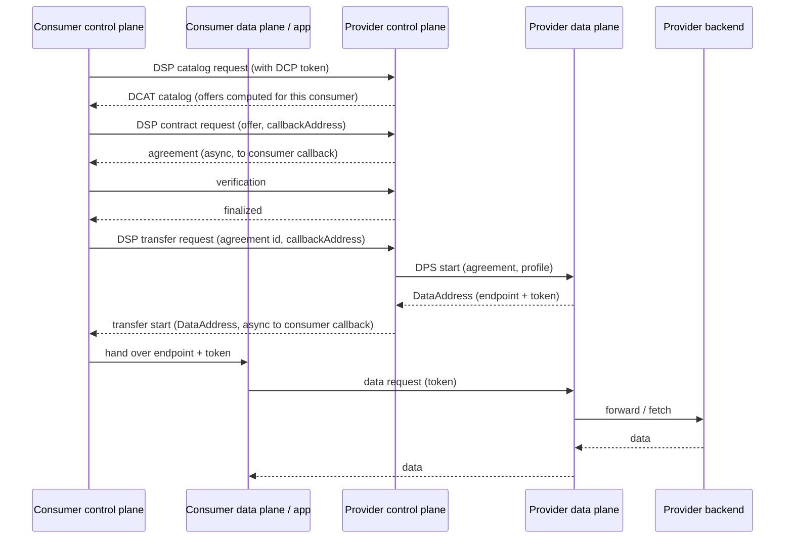
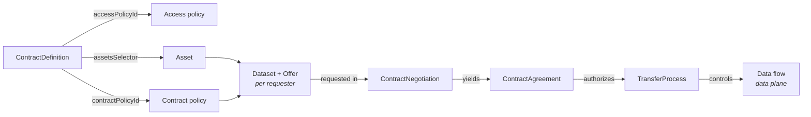
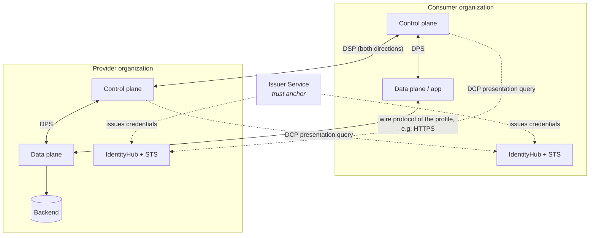
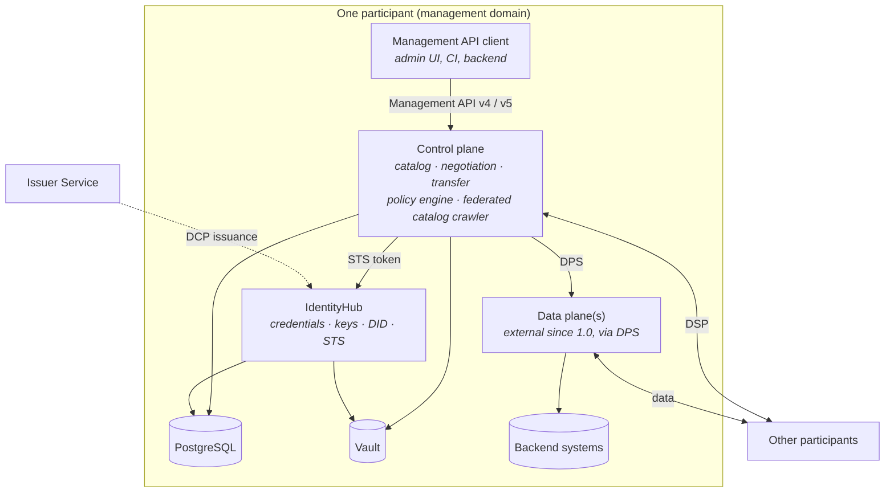

# Eclipse Dataspace Components (EDC) — Introduction and Overview

> Dated research report, 2026-10-21 (immutable snapshot — supersede with a newer dated report, do not edit).
> Repository state: `840628c` (Query Broker 0.10.1).
> Scope: Eclipse Dataspace Components as of Connector **v0.18.1** (latest stable, 2026-09-25) and
> **v1.0.0-RC5** (latest pre-release, 2026-10-21).
> Method: two parallel web-research passes against primary sources (EDC documentation site, GitHub source
> on `main` and on the release tags, the DSP/DCP/DPS specifications, Maven Central, distribution and
> adopter pages), followed by a spot re-verification of the decision-relevant claims (release list, removed
> data-plane modules on `main`, DSP callback requirement, Tractus-X Kafka data plane).
> Companion report: [eclipse-edc-fit-assessment-2026-10-21.md](eclipse-edc-fit-assessment-2026-10-21.md)
> evaluates EDC against this repository's broker architecture.
>
> Purpose: give a reader without EDC background enough of the concepts, architecture, components,
> architectural styles and configuration model to judge whether EDC fits the Query Broker integration layer.
> Version-sensitive statements are marked with the version they were checked against.

## In brief

- **What it is:** EDC is an open-source **Java toolkit for building dataspace connectors** — software with
  which two organizations agree on usage terms (a *contract*) and then exchange data under those terms. It is
  explicitly *not* a product, an integration framework, or a message bus.
- **Core idea:** strict **separation of control and data**. A *control plane* publishes a catalog,
  negotiates contracts and orchestrates transfers over the standardized **Dataspace Protocol (DSP)**; a
  separate *data plane* moves the actual bytes over whatever wire protocol fits.
- **Decentralized trust:** participants are identified by **DIDs** (in practice `did:web`) and prove
  attributes with **Verifiable Credentials** via the **Decentralized Claims Protocol (DCP)** — no central
  identity provider, no central broker.
- **Usage terms** are **ODRL policies**, evaluated by a code-first policy engine with pluggable functions.
- **Runtime style:** a **microkernel** — everything is an extension, composed at *build time* through Gradle
  BOMs, parameterized at *start time* through properties/env vars, and populated at *run time* through the
  Management API.
- **Version caveat:** EDC is mid-way through a breaking transition. **1.0.0-RC5** (released 2026-10-21)
  removes the built-in data plane (adopters bring their own, via the new **Data Plane Signaling** spec and
  SDKs), removes Management API v3, and makes multi-tenancy ("EDC-V") first-class. Much of the public
  documentation and almost all third-party material still describe the 0.x architecture (see § 9).

## Table of contents

1. [What EDC is — and is not](#1-what-edc-is--and-is-not)
2. [Basic concepts](#2-basic-concepts)
3. [Protocol layer: DSP, DCP, DPS](#3-protocol-layer-dsp-dcp-dps)
4. [Architecture and components](#4-architecture-and-components)
5. [Runtime internals and extension model](#5-runtime-internals-and-extension-model)
6. [Architectural paradigms and styles](#6-architectural-paradigms-and-styles)
7. [Configuration](#7-configuration)
8. [Ecosystem, adoption and maturity](#8-ecosystem-adoption-and-maturity)
9. [Reading the EDC documentation in late 2026](#9-reading-the-edc-documentation-in-late-2026)
10. [Sources](#10-sources)

---

## 1. What EDC is — and is not

### 1.1 Positioning

A **dataspace** is a set of organizations ("participants") that share data under agreed rules **without a
central data store and without a central intermediary**. Each participant keeps control over its data (*data
sovereignty*): it decides what it offers, to whom, under which conditions, and approves every request
individually. EDC provides the building blocks for one participant's side of this — identity, catalog,
contract negotiation, transfer control, and the hooks for data planes
([EDC documentation](https://eclipse-edc.github.io/documentation/)).

The documentation is explicit about **non-goals**: EDC is not a data-processing platform, not an integration
framework, not a message bus and not a prepackaged application. It ships **no installable distribution** —
downstream projects (e.g. Tractus-X EDC for Catena-X) assemble runtimes from its modules
([EDC documentation](https://eclipse-edc.github.io/documentation/)). Since 1.0-RC it also ships no data
plane: the data-plane framework "has been removed from the EDC project in its entirety"
([1.0.0-RC1 announcement](https://eclipse-edc.github.io/blog/2026/09/07/eclipse-dataspace-components-1.0.0-rc1-released/)).

### 1.2 Project facts

| Item | Value (checked 2026-10-21) |
|------|----------------------------|
| Governance | Eclipse Foundation project `technology.edc`, state **Incubating**, part of the **Eclipse Dataspace Working Group** ([project page](https://projects.eclipse.org/projects/technology.edc)) |
| License | Apache-2.0 |
| Language / build | Java (CI builds on JDK 17; Samples and MVD require "Java 17+"; RC1 added Java 25 compilation support) — compatible with this repo's Java 21. Gradle; artifacts on Maven Central under `org.eclipse.edc` |
| Latest stable | **v0.18.1** (2026-09-25); v0.18.0 (2026-06-30) ([releases](https://github.com/eclipse-edc/Connector/releases)) |
| Latest pre-release | **v1.0.0-RC5** (2026-10-21); RC1 2026-09-07. The 1.0.0 milestone (due 2026-09-30) has slipped; no GA date announced |
| Cadence and support | About every two months, only the latest version is maintained; every release from 0.15 onward and every RC lists breaking changes. **1.0 will not be an LTS release** ([Path to v1](https://eclipse-edc.github.io/blog/2026/03/06/the-path-to-version-1-for-the-eclipse-dataspace-components/), [release process](https://eclipse-edc.github.io/documentation/for-contributors/guidelines/release-process/)) |
| Protocols implemented | DSP **2025-1**, DCP **v1.0.1**, Data Plane Signaling **1.0-RC4** |
| Standardization | DSP and DCP are in ISO/IEC transposition as **DIS 26450 / DIS 26451**, publication anticipated late 2026 ([IDSA, 2026-09](https://internationaldataspaces.org/standardization-is-shaping-the-future-of-data-spaces/); exact ISO stage not independently verified) |

### 1.3 The project family

EDC is not one repository but a family of related projects, spread across several GitHub organizations.

| Project / repository | Role | State (2026-10-21) |
|----------------------|------|--------------------|
| [`eclipse-edc/Connector`](https://github.com/eclipse-edc/Connector) | Control plane, protocol implementations, Management APIs, policy engine; since 2026 also the **Federated Catalog** (merged 2026-03) and the multi-tenant **Virtual Connector / EDC-V** (merged 2026-07) | Active |
| [`eclipse-edc/IdentityHub`](https://github.com/eclipse-edc/IdentityHub) | Machine-to-machine wallet (credentials, keys, DID documents), Secure Token Service, **Issuer Service** | Active, versioned with Connector |
| [Data Plane Signaling](https://github.com/eclipse-dataplane-signaling) | Specification of the control-plane ↔ data-plane interface plus the transfer-profile registry | 1.0-RC4 |
| [Data Plane Core](https://github.com/eclipse-dataplane-core) | Data-plane **SDKs** (Java v1.2.1 — self-described "not production-ready"; Rust; Go) and the Rust token service *siglet* | Active, young |
| [Connector Fabric Manager (CFM)](https://projects.eclipse.org/projects/technology.cfm) | Go management plane / tenant manager for operators running "connector-as-a-service" | Incubating, v0.0.x |
| [`eclipse-dataspace-hub`](https://github.com/eclipse-dataspace-hub) | Demonstrators: **Minimum Viable Dataspace (MVD)**, **JAD** (multi-tenant SaaS demo) — explicitly not production-grade | Active |
| `Technology-Aws/-Azure/-Gcp` | Cloud integrations (now mainly vaults; cloud data planes were removed in the 1.0 line) | Active |
| [Tractus-X EDC](https://github.com/eclipse-tractusx/tractusx-edc) | The most production-hardened **distribution** (Catena-X), with Helm charts; restructuring into a dataspace-agnostic core with "flavors" | 0.13.0, based on upstream 0.17.0 |

---

## 2. Basic concepts

### 2.1 The mental model

Every interaction is **bilateral** — one *consumer*, one *provider*, each running its own connector. It
always follows the same four steps:

1. **Catalog** — the consumer asks the provider which datasets it may see; the provider computes a catalog
   *specifically for this requester*, based on the requester's credentials.
2. **Contract negotiation** — the consumer requests one of the offers; both control planes run a persisted
   state machine until a **contract agreement** exists.
3. **Transfer process** — the consumer requests a transfer under that agreement; the provider's control plane
   tells its data plane to prepare access.
4. **Data flow** — data moves on the **data plane** only: either the consumer *pulls* from an endpoint it was
   given (with an access token), or the provider *pushes* to a destination the consumer prepared. The control
   planes never carry payload.



### 2.2 Core entities

| Term | Meaning | Notes |
|------|---------|-------|
| **Participant / participant ID** | An organization's identity in a dataspace, usually a DID | `edc.participant.id`; all components of one organization share it |
| **Participant context** | A tenant inside one runtime (since 0.15); entities carry a `participantContextId` | Basis of multi-tenancy (EDC-V) |
| **Asset** | A *descriptor* of something shareable — not the data itself. Public `properties` become catalog metadata; `privateProperties` never leave the provider | Since 0.16 the data address is optional and stored in the vault; under Data Plane Signaling assets carry `dataplaneMetadata` (labels, properties, profiles) ([data plane migration](https://eclipse-edc.github.io/blog/2026/05/19/data-plane-migration/)) |
| **DataAddress** | Where and how data is reachable (type + properties, e.g. an HTTP base URL) | Under DPS produced by data planes, not managed by the control plane |
| **Policy** | An **ODRL** policy: permissions, prohibitions, obligations with constraints | Used as offer, as agreement, and for access control |
| **PolicyDefinition** | A stored policy referable by id | Managed via Management API |
| **ContractDefinition** | Binds assets (late-bound `assetsSelector`) to an **access policy** (who may *see* the offer — never disclosed) and a **contract policy** (the terms offered) | The provider's "publishing rule" |
| **Catalog / Dataset / Offer / Distribution** | DCAT catalog; one dataset per asset × matching contract definition; the offer is an ODRL offer; a distribution names transfer type and DSP endpoint | Computed per request, offers are not persisted |
| **ContractNegotiation** | Persisted state machine on both sides | Asynchronous, see § 2.3 |
| **ContractAgreement** | Immutable result: agreed policy, asset, parties, signing date | Can be *retired* (1.0-RC), which blocks further transfers |
| **TransferProcess** | State machine for one data flow under an agreement; **finite** (a file) or **non-finite** (a stream or an API that stays open; can be suspended/resumed) | Non-finite transfers are the basis for "API as asset" |
| **Transfer type / transfer profile** | How data flows: classic `HttpData-PULL`/`-PUSH`; under DPS a profile URL such as `https://w3id.org/dspace-sig/profile/http-pull` | Data planes advertise the profiles they support |
| **EDR (Endpoint Data Reference)** | Endpoint + access token a consumer receives for a pull transfer | The control-plane EDR cache is removed in 1.0; EDR handling moves into the consumer data plane |
| **DID / Verifiable Credential / trusted issuer** | Participant identifier; signed attribute claims (e.g. a `MembershipCredential`); the issuers a participant accepts | Trust anchors of the dataspace |
| **Partner / PartnerGroup, Dataspace profile** | New in 2026: named counterparties usable in policies; a profile bundles DSP version, trusted issuers, DCP scopes and policy vocabulary per dataspace | Dataspace profiles enable one runtime to serve several dataspaces (experimental) |



### 2.3 State machines — everything is asynchronous

Negotiations and transfers are **persisted state machines** with reliable, idempotent, at-least-once
messaging; a state transition commits only after the counterparty acknowledged. The documentation calls
synchronous wrappers around them an anti-pattern
([Control Plane](https://eclipse-edc.github.io/documentation/for-adopters/control-plane/)).

| Process | DSP states (2025-1) | Notes |
|---------|---------------------|-------|
| Contract negotiation | REQUESTED → OFFERED → ACCEPTED → AGREED → VERIFIED → FINALIZED (or TERMINATED) | EDC adds transitional "-ING" states internally; the provider always gives final approval |
| Transfer process | REQUESTED → STARTED ⇄ SUSPENDED → COMPLETED (or TERMINATED) | Non-finite transfers stay STARTED until suspended or terminated |

In the classic runtime the state machines are **poll-based**: each iteration leases a batch of entities per
state from the database and processes them; when idle they sleep (`iteration-wait`, default 1000 ms; batch
size 20; 7 send retries with backoff) ([Tuning](https://eclipse-edc.github.io/documentation/for-adopters/tuning/)).
EDC-V adds a task-based variant driven by **NATS JetStream**. Documented limitations: synchronized clocks
are required, duplicate protocol messages are possible, and waiting states have **no timeout**
([State machines](https://eclipse-edc.github.io/documentation/for-adopters/control-plane/state-machines/)).

### 2.4 Policies and the policy engine

- Policies are ODRL, deserialized into an object tree and **evaluated in code**. Each constraint's
  `leftOperand` (e.g. `purpose`, `MembershipCredential`) is dispatched to a registered **policy function**
  ([Policy engine](https://eclipse-edc.github.io/documentation/for-adopters/control-plane/policy-engine/)).
- Evaluation happens at fixed **policy scopes**: `catalog`, `contract.negotiation`, `transfer.process`,
  `policy.monitor`, and (1.0-RC) `approval.contract.negotiation` for manual negotiation approval.
- A **rule binding** decides *whether* a rule is evaluated in a scope; a **function binding** decides *how*.
- Bundled vocabulary is small (e.g. the "In Force" time-window policy); anything domain-specific — purpose,
  membership level, consent-like claims — needs a custom function or, experimentally, a **CEL expression**
  stored as data and bound to a left operand
  ([CEL](https://eclipse-edc.github.io/documentation/for-adopters/control-plane/policy-engine/cel/)).
- The **Policy Monitor** periodically re-evaluates the policies of running non-finite transfers and can
  terminate them.
- Scope of enforcement: policies decide **whether an organization may access an asset**. They do not filter
  records inside a dataset, and EDC does not enforce usage after data has left the provider.

| A typical ODRL offer, structurally | Example content |
|------------------------------------|-----------------|
| Rule | `permission` with action `use` |
| Constraint 1 | `leftOperand` = membership credential, `operator` = `eq`, `rightOperand` = `active` |
| Constraint 2 | `leftOperand` = purpose (custom), `operator` = `eq`, `rightOperand` = e.g. a purpose code agreed in the dataspace |
| Evaluation | Provider evaluates both against the consumer's verified credentials during catalog, negotiation and transfer |

### 2.5 Identity and trust (DCP)

1. Before each DSP call, the caller obtains a **self-issued ID token** (a JWT with `iss` = `sub` = its own
   DID) from its **Secure Token Service (STS)**; the token can embed an access token for the caller's
   credential service.
2. The receiver resolves the caller's DID document (`did:web` → HTTPS), finds its **Credential Service**,
   and queries it (`POST /presentations/query`) for the credentials the policy needs.
3. The receiver checks that the presented credentials were issued by a **trusted issuer** and are not
   revoked (status lists), then evaluates the policy.
4. Credentials are obtained from an **Issuer Service** via the DCP issuance flow.

IdentityHub supports **only `did:web`** out of the box
([Identity Hub](https://eclipse-edc.github.io/documentation/for-adopters/identity-hub/)). The older central
OAuth2/DAPS identity model is deprecated and no longer published; `iam-mock` exists for tests. OAuth2 remains
in use for securing the **Management API** (v5: scope-based, e.g. `management-api:assets:write`).

---

## 3. Protocol layer: DSP, DCP, DPS

| Protocol | Between | Purpose | Transport | Version |
|----------|---------|---------|-----------|---------|
| **Dataspace Protocol (DSP)** | Connector ↔ connector (inter-organizational) | Catalog, contract negotiation, transfer process | HTTPS + JSON-LD (JSON Schema–validated); version discovery at `/.well-known/dspace-version` | 2025-1 (errata 2); ISO/IEC DIS 26450 |
| **Decentralized Claims Protocol (DCP)** | Participant ↔ participant's credential service; holder ↔ issuer | Authentication of DSP calls, credential presentation and issuance | HTTPS, JWT-based (VCDM 1.1 or 2.0 profiles) | v1.0.1; ISO/IEC DIS 26451 |
| **Data Plane Signaling (DPS)** | Control plane ↔ data plane (intra-organizational) | Prepare/start/suspend/resume/terminate/complete a data flow, data-plane registration | HTTPS REST, optional OAuth2 authorization profiles | 1.0-RC4 |



> **Network implication (important for hospital networks).** DSP is asynchronous with callbacks: a contract
> request and a transfer request **must** carry a `callbackAddress`, and the provider later `POST`s the
> agreement and the transfer start to paths under that address (e.g.
> `/:callback/negotiations/:consumerPid/agreement`)
> ([DSP HTTPS binding](https://github.com/eclipse-dataspace-protocol-base/DataspaceProtocol/blob/main/specifications/negotiation/contract.negotiation.binding.https.md),
> [contract request schema](https://github.com/eclipse-dataspace-protocol-base/DataspaceProtocol/blob/main/artifacts/src/main/resources/negotiation/contract-request-message-schema.json)).
> Therefore **every participant — consumer and provider — needs an inbound-reachable HTTPS endpoint**, plus
> a reachable DID document and credential service. Pull transfers additionally require the provider's data
> plane endpoint to be reachable by the consumer.

---

## 4. Architecture and components

### 4.1 Component overview



| Component | Responsibility | Key interfaces |
|-----------|----------------|----------------|
| **Control plane** | Catalog assembly, contract negotiation, transfer orchestration, policy evaluation and monitoring; embeds the federated-catalog crawler by default in 1.0 | Management API, DSP API, Signaling API |
| **Data plane** | Executes data flows for one or more transfer profiles; issues/validates access tokens for pull flows | DPS endpoints `/dataflows/prepare`, `/start`, `/:id/suspend`, `/:id/resume`, `/:id/terminate`, `/:id/completed`, `/:id/status`; registers itself via `PUT /dataplanes` with its `profiles` |
| **IdentityHub** | Machine-to-machine wallet: Verifiable Credentials, key pairs (rotation, revocation), DID documents; embedded **STS** issues self-issued tokens | Identity API (admin), DCP Presentation/Storage APIs, `/did` |
| **Issuer Service** | Issues credentials via DCP, maintains status lists for revocation | Issuance API, Administration API |
| **Federated Catalog** | Crawls the catalogs of known participants periodically into a local cache and offers a query API | `POST /v4/catalogs/request` on the management context |
| **Vault** | Secrets and (since 0.16) data addresses; HashiCorp Vault in core, cloud vaults in Technology-* | `Vault` SPI |
| **Database** | All state (entities and state machines); in-memory defaults exist for tests only | SQL stores via `controlplane-feature-sql-bom` |

### 4.2 Control plane

- Owns assets, policy definitions, contract definitions, negotiations, agreements and transfer processes.
- Is **stateless at the process level**: all state lives in the database, entities are leased per runtime,
  so replicas can take over each other's work (horizontal scaling with `sql-lease`).
- Publishes **events** in-process (`EventRouter`, sync or async subscribers) and externally via per-request
  callback addresses, static callbacks (`edc.callback.<alias>.*`), CloudEvents over HTTP and (0.18+) NATS.
- The Management API "should never be exposed over the Internet"
  ([Control Plane](https://eclipse-edc.github.io/documentation/for-adopters/control-plane/)).

### 4.3 Data plane — the biggest change in 1.0

| Line | Data plane model |
|------|------------------|
| ≤ 0.18.x | Built-in **Data Plane Framework (DPF)**: `DataSource` / `DataSink` / `PipelineService` / `TransferService`; out-of-the-box HTTP (incl. an HTTP proxy with `proxyPath`/`proxyQueryParams`/`proxyMethod`/`proxyBody`) and Kafka; S3/Azure in Technology-*; legacy signaling `/api/signaling/v1/dataflows` |
| 0.18.0 | DPS becomes the default; DPF deprecated (since 0.16) |
| 1.0.0-RC1+ | DPF, Kafka data plane, `data-plane-spi`, `dataplane-base-bom` and the EDR cache **removed**. Data planes are **separate components** implementing DPS — built with the Data Plane SDKs, the Rust *siglet* token service, or a self-maintained fork of the old DPF ([migration blog](https://eclipse-edc.github.io/blog/2026/05/19/data-plane-migration/)) |

Push and pull are symmetric under DPS: for **push**, the *consumer* data plane produces the destination
`DataAddress` during *prepare*; for **pull**, the *provider* data plane produces the source `DataAddress` on
*start*. The control planes only relay it over DSP. The DPS transfer-profile registry currently publishes
only the **HTTP** profile (push and pull); no AMQP, MQTT or RabbitMQ data plane exists anywhere in the
ecosystem. The closest broker-style template is Tractus-X's **`KafkaBroker-PULL`** extension: on *start* it
provisions a per-transfer OAuth2 token and optional Kafka ACLs and returns bootstrap servers, topic and token;
*suspend* revokes the ACLs, *terminate* revokes the token — the data itself flows over Kafka, not through EDC
([Tractus-X Kafka extension](https://github.com/eclipse-tractusx/tractusx-edc/tree/main/edc-extensions/dataplane/kafka/kafka-broker-extension)).

### 4.4 APIs and default ports (control-plane runtime, `main`)

Each API is a **web context** with its own port and path (`web.http.<context>.port|path`).

| API | Context | Default port / path | Remarks |
|-----|---------|---------------------|---------|
| Management API **v4** | `management` | 8181 / `/api/management` | Single-participant; JSON Schema–validated JSON-LD (`/v4/assets`, `/v4/policydefinitions`, `/v4/contractdefinitions`, `/v4/catalog`, `/v4/contractnegotiations`, `/v4/contractagreements`, `/v4/transferprocesses`, `/v4/dataplanes`, …) |
| Management API **v5** | `management` | same | Multi-tenant: `/v5/participants/{participantContextId}/…`, OAuth2 scope-based authorization |
| Management API v3 | — | — | **Removed** in 1.0.0-RC1 (was the stable API throughout 0.x) |
| Protocol (DSP) API | `protocol` | 8282 / `/api/protocol` | Public address: `edc.dsp.callback.address`; endpoints under `/2025-1/…` |
| Signaling API | `signaling` | 8182 / `/api/signaling` | DPS callbacks from data planes; replaces the legacy Control API (9191) |
| Observability | default | 8181 / `/api` | `/check/health`, `/liveness`, `/readiness`, `/startup` |
| Version API | default | 8181 / `/api` | `GET /v1/version` |

IdentityHub has its own contexts (credentials 13131, identity 15151, did 10100, sts 9292; Issuer Service:
issuance 13132, issueradmin 15152, statuslist 9999) [V: autodoc 0.18.0].

### 4.5 Deployment topologies

- **Management domain** = "a realm of control over a set of EDC components" (catalog server, control plane,
  data plane, IdentityHub). Single-domain deployments run everything together or as separate replica sets;
  distributed domains link sub-catalogs (`@type CatalogAsset`) so that, e.g., a central catalog fronts
  departmental control/data planes
  ([Distributions, deployment, operations](https://eclipse-edc.github.io/documentation/for-adopters/distributions-deployment-operations/)).
- **Scaling guidance:** the data plane is usually the bottleneck and HA-critical — deploy and scale it
  separately; model assets coarsely so that few negotiations and transfers are needed.
- **Reference deployment (MVD):** per participant a control plane, a data plane (on the Java Data Plane SDK),
  an IdentityHub, PostgreSQL and HashiCorp Vault; a separate Issuer Service; Keycloak for Management API
  OAuth2; Traefik gateway; all on Kubernetes (KinD). The README states it is **not production-grade**
  ([MVD](https://github.com/eclipse-dataspace-hub/MinimumViableDataspace)).
- **Multi-tenant deployment (JAD / CFM):** one EDC-V control plane shared by many tenants, plus IdentityHub,
  Issuer Service, data plane, Keycloak, Vault, PostgreSQL, **NATS** and CFM
  ([JAD](https://github.com/eclipse-dataspace-hub/jad)).
- **Footprint indication:** Tractus-X Helm defaults request 500m CPU / 1 GiB each for control plane and data
  plane plus PostgreSQL — before Vault, IdentityHub and issuer
  ([values.yaml](https://github.com/eclipse-tractusx/tractusx-edc/blob/main/charts/tractusx-connector/values.yaml)).
  Rule of thumb: **≥ 3 JVM services + PostgreSQL + Vault + DID hosting per participant**.

---

## 5. Runtime internals and extension model

- **A static module system:** "At its core, EDC is just a module system" — modules are fixed at build time,
  no classloader isolation, no OSGi, and explicitly "not a framework like Spring"
  ([Extensions](https://eclipse-edc.github.io/documentation/for-adopters/extensions/)). An EDC runtime is a
  plain Java process with its own dependency injection; it is **not** embeddable in a Spring Boot
  application.
- **Hierarchy:** extensions → runtimes (a process assembled from extensions) → components (control plane,
  data plane, IdentityHub, …).
- **SPI pattern:** interfaces and extension points live in SPI modules (consolidated into a few layer modules
  such as `core-spi`, `control-plane-spi` in 2026); implementations in separate modules; consumers depend
  only on SPIs.
- **Lifecycle** of a `ServiceExtension`: LOAD (ServiceLoader discovery, dependency graph, topological sort) →
  INJECT → `initialize()` → PROVIDE (`@Provider` methods) → `prepare()` → `start()` → `shutdown()` (reverse
  order) → `cleanup()`.
- **Annotations:** `@Extension`, `@Inject` (field injection only), `@Provider` (factory; `isDefault = true` for
  fallbacks), `@Provides`/`@Requires`, `@Setting` (injects a configuration value), `@Settings` +
  `@Configuration` (typed configuration objects).
- **DI semantics:** one implementation per interface (last registration wins); no constructor, collection or
  named injection; "many implementations" cases use registries (e.g. `TypeTransformerRegistry`,
  `ApiAuthenticationRegistry`).

A minimal extension — one class plus a ServiceLoader entry
`META-INF/services/org.eclipse.edc.spi.system.ServiceExtension`:

```java
@Extension("Example backend integration")
public class ExampleExtension implements ServiceExtension {

  @Setting(key = "example.backend.url", description = "Base URL of the backend")
  private String backendUrl;

  @Override
  public void initialize(ServiceExtensionContext context) {
    context.getMonitor().info("Example extension targets " + backendUrl);
  }
}
```

**Runtime composition** happens purely through Gradle dependencies, usually BOMs:

| BOM (Connector `main`) | Content |
|------------------------|---------|
| `controlplane-base-bom` | Classic single-participant control plane, Management API v4, federated-catalog crawler; *no* `IdentityService` (fails at start unless an IAM module is added) |
| `controlplane-dcp-bom` / `controlplane-feature-dcp-bom` | Adds DCP-based identity |
| `controlplane-feature-sql-bom` | PostgreSQL stores, leases, connection pool, transactions |
| `controlplane-virtual-base-bom`, `controlplane-virtual-feature-{dcp,sql,nats}-bom` | EDC-V: Management API v5, virtual DSP paths, OAuth2 management auth, CEL, NATS task executors |
| `identityhub-*-bom`, `issuerservice-*-bom` | IdentityHub and Issuer Service runtimes |
| `dataplane-base-bom` | Exists in 0.18.1 only — **removed** in 1.0-RC |

---

## 6. Architectural paradigms and styles

| Paradigm / style | How EDC realizes it |
|------------------|---------------------|
| **Decentralized, peer-to-peer** | No central broker or registry is required; each participant runs its own connector; DSP is strictly bilateral ("a dataspace is simply a context between two participants"); DCP removes the central IdP |
| **Control/data plane separation** | Governance (who may access what, under which terms) is separated from data movement; data planes are independently deployable and scalable, and since 1.0 even independently implemented |
| **Asynchronous, state-machine-driven processing** | Negotiations and transfers are persisted state machines with at-least-once, idempotent messaging and eventual consistency; synchronous wrappers are discouraged |
| **Microkernel / plugin architecture** | Small boot kernel, ServiceLoader-discovered extensions, static composition at build time |
| **Ports and adapters (hexagonal) via SPIs** | Stores, vaults, identity services, dispatchers and data-plane signaling are SPIs with swappable adapters |
| **REST + Linked Data** | DSP and Management APIs are JSON-LD (validated by JSON Schema since DSP 2025-1 / Management API v4); vocabularies DCAT, ODRL, DSPACE |
| **Event-driven integration** | In-process event bus, webhooks/callbacks, CloudEvents, NATS event publishing |
| **Policy-as-code / contract-based access** | ODRL policies evaluated by registered functions or CEL expressions at defined scopes |
| **Self-sovereign identity** | DIDs + Verifiable Credentials, holder-controlled presentation |
| **Cloud-native, twelve-factor configuration** | Separate processes per component, health probes, OpenTelemetry, configuration via env vars; Kubernetes is the reference platform (core ships no images or Helm charts — distributions do) |
| **Multi-tenancy (EDC-V)** | Participant contexts, Management API v5, per-participant configuration and vault partitions, scope-based OAuth2; multi-dataspace "profiles" experimental |
| **Push, pull, streaming, API access** | Finite vs non-finite transfers, suspend/resume; streaming and API access are the job of the external data plane |

What EDC **deliberately does not provide**: a message bus or queueing semantics (NATS is used only
internally), broadcast/fan-out, query semantics or result aggregation across providers, payload-level
semantics (it is content-agnostic), compute-to-data, or synchronous request/response at the control-plane
level.

---

## 7. Configuration

EDC is configured on five layers. Understanding which layer a decision lives on is essential when judging
integration effort.

| Layer | What is decided | Mechanism |
|-------|-----------------|-----------|
| 1. **Build-time composition** | Which features exist at all: IAM (DCP vs mock), persistence (SQL vs in-memory), vault implementation, Management API v4 vs v5, custom extensions | Gradle dependencies on BOMs and modules |
| 2. **Start-time settings** | Ports, hostnames, participant ID, DB connections, vault, trusted issuers, API authentication, tuning | Properties / env vars / system properties, injected via `@Setting` |
| 3. **Run-time state** | Assets, policy definitions, contract definitions, data-plane registrations, secrets, participants, CEL expressions, per-participant configuration (EDC-V — no restart needed) | Management API v4/v5, Identity API |
| 4. **Behaviour in code** | Custom policy functions, validators, transformers, data planes, event subscribers | Extensions against SPIs; DPS implementations |
| 5. **Deployment** | Replicas, network exposure, ingress, secrets injection | Distribution-specific (Kubernetes manifests, Tractus-X Helm charts, CFM chart) |

**Settings sources and precedence** (verified in `ConfigurationLoader`/`ConfigImpl` on `main`): Java
**system properties > environment variables > properties file** (`edc.fs.config` / `EDC_FS_CONFIG`) or a
custom `ConfigurationExtension`. Environment variables are mapped by lower-casing and replacing `_` with `.`
(`EDC_HOSTNAME` → `edc.hostname`, `WEB_HTTP_MANAGEMENT_PORT` → `web.http.management.port`) — keys that
themselves contain `_` or `-` are therefore awkward or impossible to set via env vars.

**Key settings** (selection):

| Key | Purpose |
|-----|---------|
| `edc.participant.id` | Participant ID (usually a DID); `edc.participant.context.id` for the single-participant context |
| `edc.hostname`, `edc.dsp.callback.address` | Public hostname and public DSP endpoint (the callback address counterparties use) |
| `web.http.<ctx>.port`, `web.http.<ctx>.path` | Port/path per web context (`management`, `protocol`, `signaling`, default) |
| `web.http.<ctx>.auth.type` (`tokenbased` / `delegated`), `.auth.key` / `.auth.key.alias` | API protection: static API key (`X-Api-Key` header) or delegated JWT/JWKS validation |
| `edc.iam.oauth2.issuer`, `edc.iam.oauth2.jwks.url` | OAuth2 for Management API v5 |
| `edc.iam.sts.oauth.token.url`, `.client.id`, `.client.secret.alias` | DCP: remote STS client |
| `edc.iam.trusted-issuer.<alias>.id`, `.supportedtypes` | Trust anchors (also per dataspace profile in 1.0-RC) |
| `edc.iam.dcp.scopes.<alias>.*` | Credential scopes requested during DCP presentation queries |
| `edc.datasource.<alias>.url/user/password`, `edc.sql.schema.autocreate` | PostgreSQL persistence |
| `edc.vault.hashicorp.url`, `edc.vault.hashicorp.token` (+ token-exchange auth) | HashiCorp Vault |
| `edc.<sm>.state-machine.batch-size`, `.iteration-wait-millis`, `edc.<sm>.send.retry.*` | State-machine tuning (`<sm>` = `negotiation.consumer`, `negotiation.provider`, `transfer`, `policy.monitor`) |
| `edc.catalog.cache.execution.*` | Federated-catalog crawl schedule |
| `edc.callback.<alias>.*`, `edc.events.cloudevents.endpoint`, `edc.events.nats.*` | Event delivery to external systems |

Real-world example — the MVD provider control plane (abbreviated; MVD `main` targets EDC 0.19.0-SNAPSHOT)
([source](https://github.com/eclipse-dataspace-hub/MinimumViableDataspace/blob/main/k8s/provider/application/controlplane-config.yaml)):

```properties
edc.participant.id=did:web:identityhub.provider.svc.cluster.local%3A7083:provider
edc.iam.sts.oauth.token.url=http://identityhub.provider.svc.cluster.local:7084/api/sts/token
web.http.protocol.port=8082
web.http.protocol.path=/api/dsp
web.http.management.port=8081
web.http.management.path=/api/mgmt
web.http.signaling.port=8182
edc.datasource.default.url=jdbc:postgresql://postgres.provider.svc.cluster.local:5432/controlplane
edc.iam.trusted-issuer.issuer.id=did:web:issuerservice.issuer.svc.cluster.local%3A10016:issuer
```

---

## 8. Ecosystem, adoption and maturity

### 8.1 Distributions and adopters

| Distribution / adopter | Notes |
|------------------------|-------|
| **Tractus-X EDC** (Catena-X, automotive) | Most production-hardened; Helm charts; DSP 0.8 compatibility layer; Kafka streaming extension; lags upstream by about one minor version; moving to a dataspace-agnostic core with flavors (Catena-X, Factory-X, Construct-X) |
| **sovity EDC CE** | Elastic License 2.0 by default; based on an old fork (EDC 0.11.x) |
| **Simpl-Open (EU)** | Adopted DSP; EDC-derived connector on an older line (partly verified) |
| **Gaia-X** | Lighthouse projects use EDC with Gaia-X credentials; the EDC Gaia-X trust-framework repo was archived 2026-09 |

### 8.2 Health

| Project | EDC role | Status |
|---------|----------|--------|
| **Dataspace4Health** (Luxembourg, Gaia-X lighthouse) | Full catalog → negotiation → transfer between a hospital and a research institute, HealthDCAT-AP metadata | Pilot ([Gaia-X, 2026-08](https://gaia-x.eu/dataspace4health-a-gaia-x-lighthouse-project-moving-from-reference-architecture-to-working-components/)) |
| **Flemish Health Data Space** (imec) | EDC/DSP with a custom clearing-house extension that pauses negotiations for authority (HDAB-like) approval | Research implementation ([CEUR Vol-4007](https://ceur-ws.org/Vol-4007/02short.pdf)) |
| **HealthData@EU** (EHDS secondary use) | **No EDC/DSP** — central platform uses eDelivery AS4 and exchanges metadata and access applications, not health data | Operational ([TEHDAS, 2026-05](https://tehdas.eu/results/new-specification-supports-member-state-connection-to-healthdataeu/)) |
| **German EHDS network** (BMG funding call 2026-07) | No mention of connectors, DSP or EDC | Call |
| **MII / NUM** | No EDC usage found; cross-site processes run on the **Data Sharing Framework (DSF)** — FHIR R4 + BPMN, mTLS with X.509 certificates, FHIR endpoint in the DMZ, process engine internal; v2.1.1; FDPG feasibility runs as a DSF plugin | Production ([DSF](https://dsf.dev/llms-full.txt), [mii-process-feasibility](https://github.com/medizininformatik-initiative/mii-process-feasibility)) |

No maintained FHIR-specific EDC data plane was found. In the health domain EDC is at pilot/research stage;
the relevant production precedent in German university medicine is DSF.

### 8.3 Maturity signals

- Positive: Eclipse governance, open specifications on an ISO track, an active core team, a clear
  architectural direction (protocol-first, DPS, multi-tenancy), production use in automotive (Catena-X).
- Caution: still *Incubating*; 1.0 is a functional-completeness milestone, **not LTS**; large refactorings
  landed even in the release candidates (SPI consolidation, Atomikos removal, entity versioning); deprecated
  features are removed after about two releases; every adopter must now own a data plane; the Java Data Plane
  SDK calls itself "not production-ready"; components are fragmented across seven GitHub organizations.

---

## 9. Reading the EDC documentation in late 2026

When studying EDC further, keep these discrepancies in mind (checked 2026-10-21):

1. Several documentation pages (Adopters → Data Plane, Contributors → Data Plane / Data Plane Signaling,
   Distributions) still describe the **removed** Data Plane Framework, `HttpData-PULL`, the legacy
   `/api/signaling/v1/dataflows` interface and `dataplane-base-bom`. For 1.0, treat the **DPS specification**
   and the **RC1 announcement** as authoritative.
2. The published **autodoc** settings reference is at 0.18.0 and lists modules that no longer exist.
3. The adopters' Control Plane page still documents provisioning states (`PROVISIONED`/`DEPROVISIONED`) that
   were removed from `TransferProcessStates` on `main`.
4. Links to MVD point to `eclipse-edc/MinimumViableDataspace`; it now lives in `eclipse-dataspace-hub`.
5. Most tutorials, blog posts and distributions (Tractus-X 0.13, sovity, Simpl) target **0.x** with
   Management API v3 and the built-in data plane — useful for concepts, misleading for 1.0 implementation
   details. The Samples repository deleted all transfer samples on 2026-10-14.

---

## 10. Sources

Primary sources (all accessed 2026-10-21):

| Topic | Source |
|-------|--------|
| Documentation (adopters/contributors) | <https://eclipse-edc.github.io/documentation/> |
| Releases and source | <https://github.com/eclipse-edc/Connector> (tags v0.18.1, v1.0.0-RC5; decision records under `docs/developer/decision-records/`), <https://github.com/eclipse-edc/IdentityHub> |
| Roadmap and transition | [Path to v1 (2026-03-06)](https://eclipse-edc.github.io/blog/2026/03/06/the-path-to-version-1-for-the-eclipse-dataspace-components/), [Data Plane Signaling (2026-01-19)](https://eclipse-edc.github.io/blog/2026/01/19/data-plane-signaling/), [Management API versions (2026-02-19)](https://eclipse-edc.github.io/blog/2026/02/19/management-api-upcoming-versions/), [Data plane migration (2026-05-19)](https://eclipse-edc.github.io/blog/2026/05/19/data-plane-migration/), [1.0.0-RC1 (2026-09-07)](https://eclipse-edc.github.io/blog/2026/09/07/eclipse-dataspace-components-1.0.0-rc1-released/) |
| Dataspace Protocol 2025-1 | <https://eclipse-dataspace-protocol-base.github.io/DataspaceProtocol/2025-1/>, spec sources <https://github.com/eclipse-dataspace-protocol-base/DataspaceProtocol> |
| Decentralized Claims Protocol v1.0.1 | <https://eclipse-dataspace-dcp.github.io/decentralized-claims-protocol/v1.0.1/> |
| Data Plane Signaling | <https://eclipse-dataplane-signaling.github.io/dataplane-signaling/HEAD/>, <https://github.com/eclipse-dataplane-signaling/profiles> |
| Data Plane SDKs | <https://github.com/eclipse-dataplane-core> |
| Demonstrators | <https://github.com/eclipse-dataspace-hub/MinimumViableDataspace>, <https://github.com/eclipse-dataspace-hub/jad> |
| Governance | <https://projects.eclipse.org/projects/technology.edc>, <https://projects.eclipse.org/projects/technology.cfm> |
| Distributions | <https://github.com/eclipse-tractusx/tractusx-edc>, <https://github.com/sovity/edc-ce> |
| Standardization | [IDSA on ISO/IEC DIS 26450/26451](https://internationaldataspaces.org/standardization-is-shaping-the-future-of-data-spaces/) |
| Health adoption | See § 8.2 |
